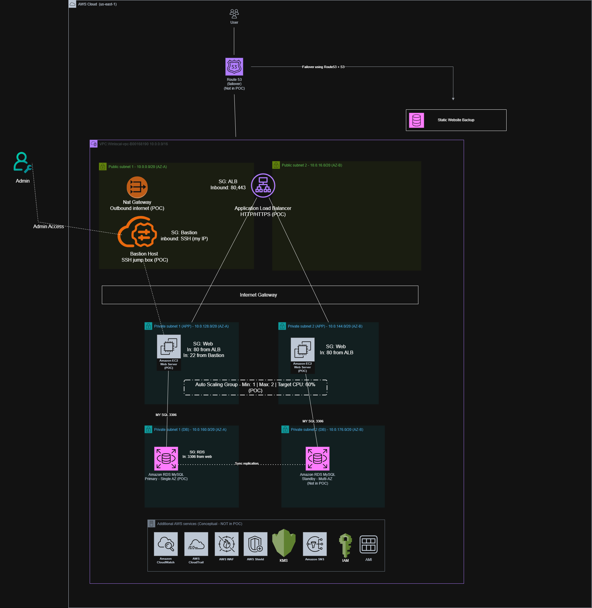
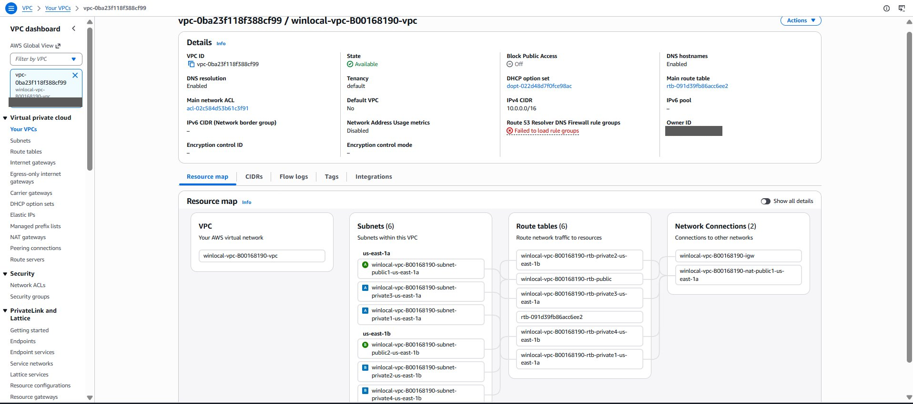
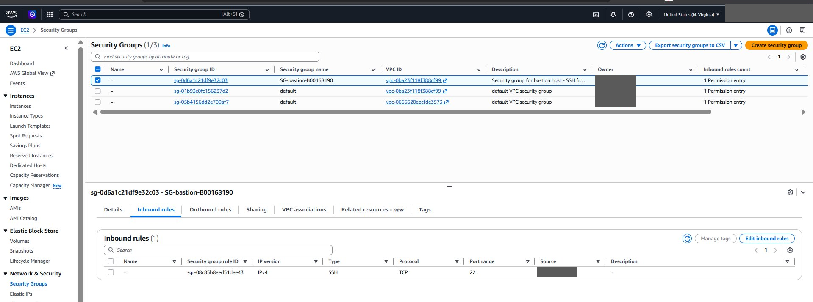
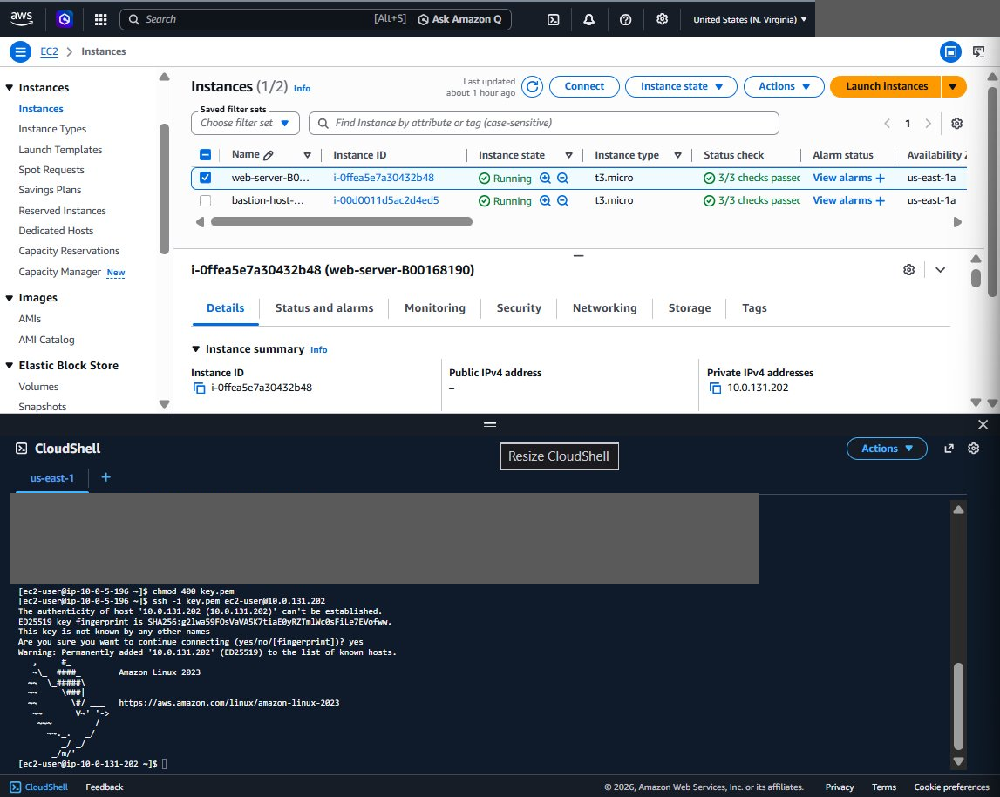
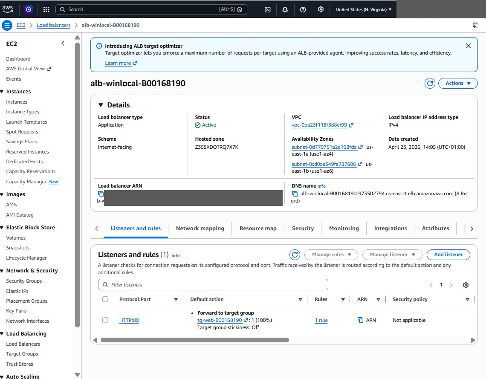
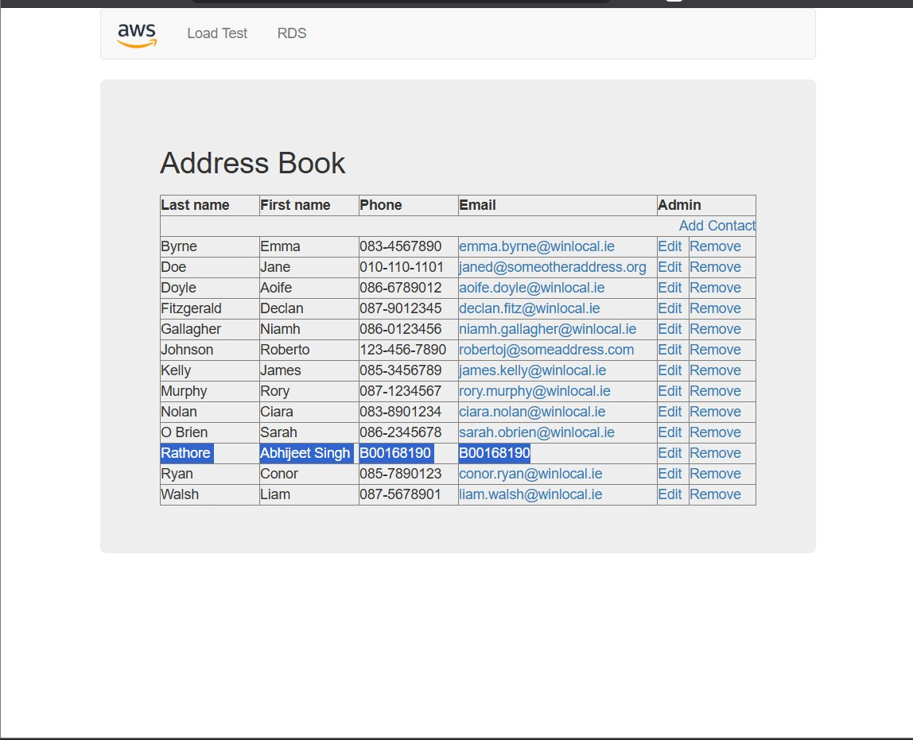
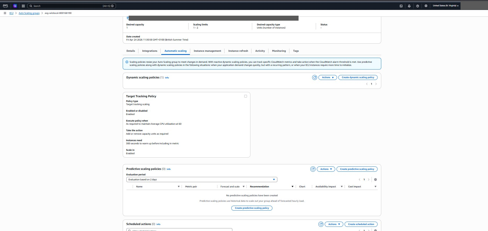
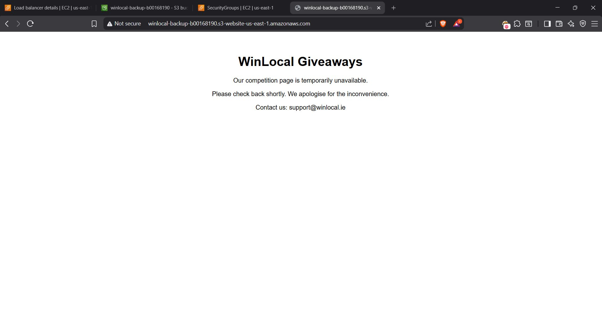

# WinLocal AWS proof of concept

A secure AWS architecture I designed and then built as a working proof of concept for WinLocal Giveaways, a fictional Dublin startup that runs competitions for local businesses. Individual project for the Security Architecture module (COMP H2701) at TU Dublin, April 2026, built in AWS Academy Learner Lab.

WinLocal's on-premises setup had four problems: a load balancer that failed without warning, a database that ran out of space and crashed the site, no way to cope with traffic spikes from viral campaigns, and a flat network that had already let ransomware spread to every server. My design answers each one. I then built the core of it and tested that a customer request passes from the load balancer to a private web server and the database and back.

## How the design fixes each problem

| WinLocal's problem | What I used | How it helps |
| --- | --- | --- |
| Load balancer failing, site going down | Application Load Balancer across two Availability Zones | If one web server fails, traffic goes to the healthy one. A Route 53 failover to an S3 holding page is planned for a full outage |
| Database running out of space | Amazon RDS MySQL | AWS manages storage, backups and patching |
| Traffic spikes from campaigns | EC2 Auto Scaling (1 to 2 servers, target 60% CPU) | A second server starts when CPU goes over 60% and stops when traffic drops |
| Ransomware spreading across a flat network | Three network tiers with a security group per tier | The database only accepts traffic from the web servers, and the web servers can't be reached from the internet |

## Network layout

| Subnet | CIDR | AZ | Contents |
| --- | --- | --- | --- |
| Public 1 | 10.0.0.0/20 | us-east-1a | ALB, bastion host, NAT gateway |
| Public 2 | 10.0.16.0/20 | us-east-1b | ALB |
| Private app 1 | 10.0.128.0/20 | us-east-1a | Web server |
| Private app 2 | 10.0.144.0/20 | us-east-1b | Web server (when scaled out) |
| Private DB 1 | 10.0.160.0/20 | us-east-1a | RDS primary |
| Private DB 2 | 10.0.176.0/20 | us-east-1b | RDS standby (planned) |

## Security groups

| Security group | Protects | Allows in |
| --- | --- | --- |
| SG-alb | Load balancer | HTTP (80) from anywhere |
| SG-bastion | Bastion host | SSH (22) from my IP address only |
| SG-web | Web servers | HTTP from the ALB, SSH from the bastion |
| SG-rds | Database | MySQL (3306) from the web servers only |

Each tier only accepts traffic from the tier above it. An attacker who got into the load balancer still couldn't reach the database directly, which is the opposite of WinLocal's old network.

## What I built

Every resource is named with my student number so it can be traced.

**VPC and subnets.** Six subnets across two Availability Zones, with route tables that send public traffic through the internet gateway and keep the private subnets isolated.

**Bastion host.** The only server that accepts SSH, and only from my IP. I connected to the bastion (10.0.5.196) and then hopped from it to the private web server (10.0.131.202), which has no public IP. That is the only way in.

**AMI template.** After setting up the web server I saved it as an AMI. Auto Scaling launches new servers from it, so they're ready in minutes without manual setup.

**RDS database.** MySQL on db.t3.micro in the private database subnet, with no public access, reachable only from the web servers on port 3306.

**Application Load Balancer.** Internet-facing, spanning both AZs, forwarding HTTP to the web server target group.

**End-to-end test.** The web app's address book reads from RDS through the ALB and the private web server. I added my own entry (highlighted) to prove the write path works too.

**Auto Scaling.** A minimum of 1 and maximum of 2 instances, with a target tracking policy holding average CPU at 60%.

**S3 backup page.** A static site that shows a WinLocal-branded maintenance message instead of a browser error if the app goes down.

## Built vs planned for production

| Built in the proof of concept | Planned for production |
| --- | --- |
| VPC, subnets, internet gateway | Route 53 DNS failover |
| Application Load Balancer | Second NAT gateway in AZ-B |
| EC2 web servers with Auto Scaling | Multi-AZ RDS standby |
| Bastion host and security groups | AWS WAF and AWS Shield |
| RDS MySQL (single AZ) | CloudWatch and CloudTrail |
| S3 backup page and AMI template | KMS encryption and SNS alerts |

The proof of concept uses one NAT gateway and a single-AZ database to keep it small and cheap. Both get a second copy in production.

## Recommended next services

- **AWS WAF** in front of the ALB. The competition forms take input from unregistered users, so they're open to SQL injection and XSS, and to bots submitting thousands of entries. WAF's managed rules and rate limiting cover these, and WinLocal has already had one breach.
- **Amazon CloudWatch.** WinLocal's database filled up with no warning. CloudWatch alarms on storage, ALB errors and unhealthy hosts would catch that before customers notice. Auto Scaling already depends on its CPU metric.

## Sustainability and cost

I used t3.micro instances and let Auto Scaling add capacity only when it's needed, rather than running peak capacity all day. The backup page is on S3, not on a second EC2 instance. For later, I suggested Graviton (t4g) instances, scheduled scaling around known campaign launches, and Aurora Serverless for the database.

## Tools

AWS (VPC, EC2, AMI, Auto Scaling, Application Load Balancer, RDS MySQL, S3, security groups), CloudShell, SSH, draw.io

## Notes

Built in a temporary AWS Academy lab account that no longer exists. Account IDs, my source IP address and an SSH key visible in CloudShell have been blacked out of the screenshots.
